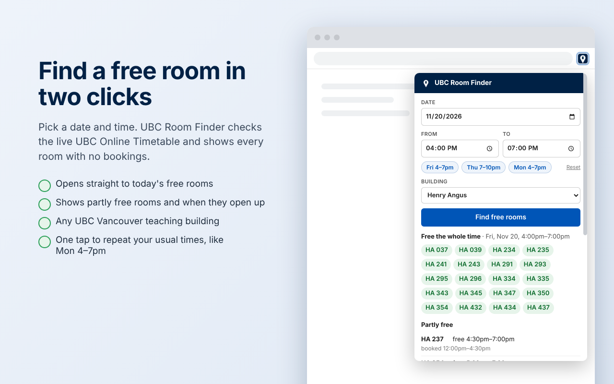

# UBC Room Finder

A Chrome extension that finds free UBC Vancouver teaching rooms for any date and time, in two clicks.



## Why I built this

I'm VP DAC for UBC Sauder's JDC West delegation, and our Challenge team practices twice a week. Every practice needed a room, and finding one took 10–15 minutes: finding the UBC Online Timetable link, choosing the right parameters (every Henry Angus room, the week, the day, the report type), and making sense of a long list of bookings to spot a room nobody had booked during our slot. The other JDC teams had it worse. Their schedules kept changing, so most of them found practice rooms by walking the building and checking every room in person.

It was the same few steps every time, so I automated them. The first version was a bookmarklet my teammates could click on the timetable page. This version is a Chrome extension that works from any tab, remembers our usual practice times, and covers every teaching building on campus. Finding a room now takes two clicks, and any UBC student who needs a study or meeting room can use it.

## What it does

- Opens straight to today's free rooms in your building
- Lists rooms that are **free the whole time**, rooms that are **partly free** (with when they open up), and rooms that are fully booked
- One-tap buttons for recent searches, like `Mon 4–7pm`
- Remembers your usual time for each weekday, plus your building
- **Copy room list** to paste the results into any chat
- Works for any UBC Vancouver general teaching building

## How it works

UBC's timetable (SWS) is an ASP.NET WebForms site behind CWL login, with no public API. Room Finder runs entirely in the browser and has no server.

1. **Uses the user's own session.** The extension has host permission for `sws-van.as.it.ubc.ca` only, so its requests carry the cookies from the user's existing CWL sign-in. Credentials never pass through the extension.
2. **Replays the WebForms flow.** It loads the timetable, triggers the `General Teaching Spaces` postback, and submits the room form with the same `__VIEWSTATE` and fields a person would: every room in the building, the matching week (worked out from the week labels' "w/c" dates), the weekday, and the "List Timetable" report type.
3. **Parses the report.** It finds the header row by column name (`Location`, `Start Time`, `End Time`), not by position, so a reordered column doesn't break it.
4. **Does the interval maths.** For each room it merges the bookings that overlap the requested range, removes duplicates, and works out the free gaps. A room is "free" only if no booking overlaps at all.
5. **Handles expired sessions.** Requests use `redirect: 'manual'`, so a bounce to the CWL login page shows up as a sign-in prompt instead of a confusing network error.

```
extension/
  manifest.json   Manifest V3, one host permission, no remote code
  sws.js          Timetable client: session discovery, form replay, report parsing, free/partial/booked logic
  popup.html/css/js   UI: date/time/building, recent searches, results, copy
test/
  fake_sws.py     Stand-in timetable that mimics the real pages (forms, week labels, report tables, CWL redirect)
  run_tests.py    Loads the real extension in Chrome and runs 22 end-to-end checks against the fake timetable
store/            Chrome Web Store listing text and the scripts that render its images
tools/            Icon generator
```

## Install

- **Chrome Web Store:** _link coming soon_
- **From source:** download this repo, open `chrome://extensions`, turn on **Developer mode**, click **Load unpacked**, and select the `extension` folder.

Then sign in to the [UBC Online Timetable](https://sws-van.as.it.ubc.ca/) once with CWL and click the Room Finder icon on any tab.

## Running the tests

The tests load the unpacked extension in Chrome and point it at a fake timetable, so they don't need a CWL account or network access.

```bash
pip install playwright
playwright install chromium
python test/run_tests.py
```

Set `CHROME_PATH` to use a specific Chrome install. The tests cover the free/partial/booked results, duplicate bookings, building and week selection, remembered and recent times, reset, invalid input, dates outside the session, and the signed-out flow.

## Privacy

Room Finder only talks to the UBC Online Timetable, using your own signed-in session. It doesn't collect or send your data anywhere and has no backend. Your recent times and building are saved locally in your browser.

## Limitations

- Read-only. It doesn't book rooms.
- Tentative holds and very recent bookings may not show up in the timetable.
- The timetable only covers 7am–10pm and the current session.
- If UBC changes how the timetable site works, the parser may need updating.

## Disclaimer

Unofficial tool. Not affiliated with or endorsed by the University of British Columbia.

## License

[MIT](LICENSE)
